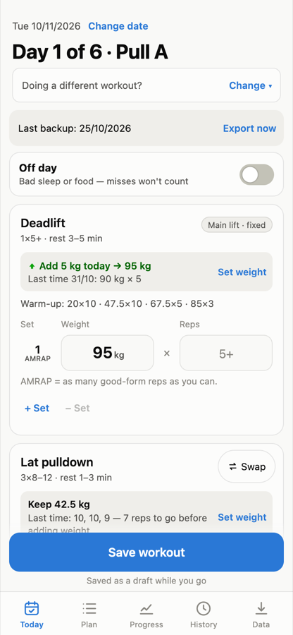
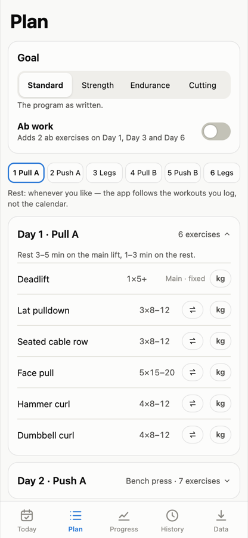
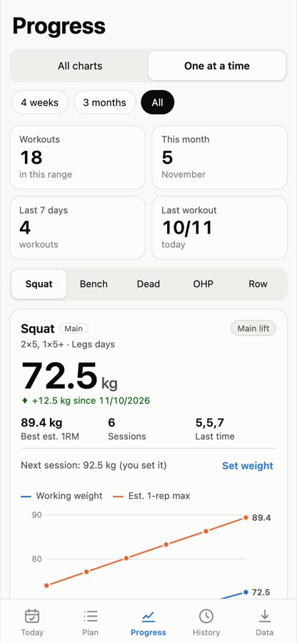
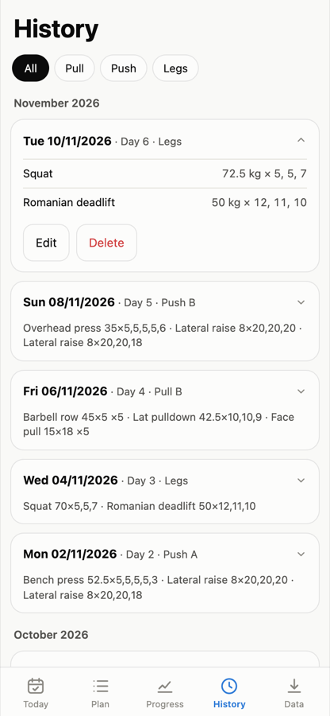
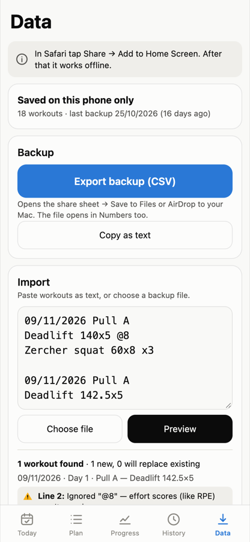

# PPL Tracker

An offline iPhone home-screen web app for the r/Fitness **"A Linear Progression Based PPL Program for Beginners"** (Metallicadpa PPL). It plans each workout, fills in the weights, applies the program's progression and deload rules, and shows progress over time. No accounts, no server, no network: all data stays on the phone, with a CSV backup the user can save or AirDrop.

**Live:** https://workout-tracker-5ik.pages.dev. In Safari, tap Share → Add to Home Screen, then use the icon; it works offline after the first load.

| Today | Plan | Progress | History | Data |
|---|---|---|---|---|
|  |  |  |  |  |

## What it does

- **Day 1–6 cycle:** Pull A → Push A → Legs → Pull B → Push B → Legs. The cycle follows the workouts you log, never the calendar: skipped days change nothing, and the app never says "missed".
- **Weights filled in for you:**
  - main lifts go up 2.5 kg (deadlift 5 kg) after a clean session;
  - after 3 misses in a row at the same weight, 10% comes off;
  - accessories go up once every set hits the top of the rep range: 2.5 kg, or 5 kg on machines and cables;
  - an exercise done twice in a workout (the two lateral raises on Push days) keeps two separate histories;
  - plank is timed: aim for your shortest hold + 5 s, and 60 s on every set adds a plate;
  - the main lift shows its warm-up as a checklist to tick off;
  - an off-day switch stops a bad session counting as a miss.
- **Weights are the total:** barbell cards say "Total weight" and show the plates for each side ("= 20 kg bar + 21.25 kg each side"; not on EZ-bar or landmine lifts, whose bar is different); machines show the stack, dumbbells one dumbbell, bodyweight exercises the weight you add.
- **At the gym:** committing a set's reps starts a rest timer inside the card, right under that set ("Rest 0:48 · aim 1–3 min"); it says when you're ready and when you're over, beeps once (switch it off in Data → Settings), and +30 s / Skip adjust it. It survives switching tabs and reopening the app.
- **Recorded rest and set times:** the rest box has a **Start set 2** button (or **Start round 2 · Triceps pushdown**, or **Start next exercise**): tapping it saves the rest on that set and starts a set timer, which stops when you commit the reps. Each set shows "rest 2:41 · set 0:38" under it; History lists them per exercise with the average rest, and the backups keep them. With no timer running, the next set has a small **Start set N** button.
- **Supersets as one:** after a pushdown set the paired lateral-raise set starts by itself, with no rest in between; there is one rest per round.
- **Start workout:** a big **Start workout** button under Today's heading starts the workout clock on purpose (it survives a reload before any reps); it turns into "Started 18:40 · 0 min so far". Forget it and the workout still starts at the first warm-up tick, Start tap or reps typed. It starts no timer.
- **Screen stays on while a timer runs:** during a rest or set timer the app keeps the iPhone screen awake (Screen Wake Lock), and lets it sleep again after Skip, Cancel or Save. Switch it off in Data → Settings.
- **Workout times:** the start (the Start workout tap, else the first warm-up tick, Start tap or reps typed, whichever comes first) and finish (Save) are kept with each workout, shown in History ("18:42 – 19:34 · 52 min") and in the backups. Today shows "Last workout: Wed 18/11 at 19:41", then "Started 18:42 · 23 min so far". A workout counts as one sitting of up to 4 hours: a draft saved the next morning keeps its start but no finish. Workouts logged before this have no times ("Time not recorded").
- **Done for today:** after saving, Today shows "Done for today ✓" with the day's workout until midnight, then the next one. "Start it now instead" is there for a double day.
- **New bests:** saving celebrates any exercise that beat its heaviest weight (plank: longest hold) with a "Workout saved" summary; 🏆 and "best" tags mark them on Today and in History.
- **Set weight:** sets the weight for any exercise's next session, once. After that the rules take over. The same sheet sets the exercise's own weight step (it stays until you change it), and the same list sets starting weights on first open.
- **Swaps:** the substitutions from the Reddit post, plus custom names. Also goals (standard / strength / endurance / cutting) and an optional ab add-on. "+ Add exercise" searches the list as you type; the new card opens on screen.
- **Progress:** two views. *All charts* has a card per exercise; *One at a time* shows one big chart plus the full exercise list. Main lifts chart working weight and estimated 1-rep max; accessories chart weight and total reps against the "add weight" target. Also a watch list, personal bests and weekly volume.
- **Backup:** export a CSV through the iOS share sheet (workout times included); "Copy as text" copies a readable version. Import takes that CSV, or free text like `Deadlift 100x5 x3`, and shows a preview with warnings by line number first.
- **Settings:** kg by default with an lb switch that converts saved weights; the barbell weight (20 kg / 45 lb by default) used for the plates and the warm-up; the rest timer sound; "Keep screen on during timers" (on by default; it says so when the browser can't). Dates show as DD/MM/YYYY, and typed numeric dates are always read day-first.
- **Storage meter:** Data shows how much of the phone's roughly 5 MB the app uses, and warns in amber above 80%. If the phone's storage is full, Save says "Couldn't save on this phone (storage full?) — export a backup now" instead of "Saved".

## Run it locally

No dependencies and no build step. Serve `public/` with any static server:

```sh
python3 -m http.server 8000 --bind 127.0.0.1 --directory public
# open http://127.0.0.1:8000/
```

The service worker (offline mode) works on `127.0.0.1`/`localhost` and on HTTPS. A phone on your Wi-Fi visiting the Mac's IP over plain HTTP can view the app but won't get offline mode.

## Tests

| Command | What it runs | Needs |
|---|---|---|
| `npm test` | 645 unit tests for every logic module (Node's built-in runner) | Node 22+ (developed on 24) |
| `TZ=Asia/Kolkata npm test` | the same, in another time zone (date logic must not shift) | |
| `node tests/e2e/run.js` | 63 end-to-end scenarios in headless Chrome at iPhone size, plus "no outside requests" and "no console errors" | Google Chrome (set `CHROME_PATH` if it isn't in /Applications) |
| `node tests/e2e/run.js swap offline` | only the scenarios whose id contains those words | |
| `node tests/e2e/selfcheck.js` | checks the e2e harness itself | |

The e2e tests find elements by **accessible name** (button text, `aria-label`), so renaming a button or label can break them. The names are a contract, listed in [`docs/SPEC.md` §16.3](docs/SPEC.md). End-to-end screenshots go to `/tmp/ppl-shots/e2e/`.

## Layout

```
public/                 ← the deployed site (and only this folder)
  index.html, css/app.css, manifest.webmanifest, sw.js, icons/
  js/
    program.js          the program: exercises, days, slots, swaps, goals, rest ranges, Day 1–6 cycle
    progression.js      suggestions: increase / repeat / deload, accessory rules, warm-ups, Set weight
    units.js            increments, rounding, kg↔lb, weight formatting
    dates.js            local calendar dates and workout times, DD/MM/YYYY, day-first parsing
    parser.js           free-text import/export
    csv.js              CSV backup format
    store.js            app state, localStorage load/save/migrate, merging imports
    timers.js           the rest / set timer, what comes next after a set (superset rounds, next exercise), and
                        whether the screen stays on
    analysis.js         Progress numbers: e1RM, series, PBs, new bests, weekly volume, watch list
    charts.js           SVG chart markup (pure)
    html.js             the one HTML escaper
    app.js              boot, routing between tabs, saving, service worker, banners
    ui/                 one module per screen + shared sheets, DOM helpers, chart interaction, the rest and set
                        timer boxes (rest.js), workout summaries shared by Today and History (summary.js) and the
                        screen wake lock (awake.js)
tests/                  unit tests (*.test.js) and tests/e2e/ (browser tests + harness)
tools/make-icons.mjs    regenerates every icon + favicon.ico (headless Chrome + sips; not deployed)
docs/                   SPEC.md, DECISIONS.md, design/ (approved mocks), screenshots/
```

## Rules for changing it

1. **No dependencies, no build step, no network calls**, no CDN, no web fonts. The app must work in airplane mode.
2. **Every rule lives in one logic module.** The UI never re-implements one: suggestions come from `progression.js`, the cycle from `program.js`, rounding from `units.js`, dates from `dates.js`. Logic modules are pure (no DOM, no storage at import time) so Node can test them.
3. **Dates are local `YYYY-MM-DD` strings.** Never use `toISOString()` for "today": in India it gives yesterday before 05:30.
4. **All user text is escaped** (`html.js` / the `html` template tag in `ui/dom.js`).
5. **Tests first:** change or add the tests for a rule, then the code. Run both suites before pushing.
6. **When anything in `public/` changes, bump `CACHE` in `public/sw.js`** (`ppl-v8` → `ppl-v9`) and keep its `PRECACHE` list equal to the real file list. Otherwise installed phones keep the old version. The app shows "Update ready — tap to reload" when a new version arrives.
7. **Keep stored data compatible.** State lives in `localStorage` under `ppl-tracker-v1`; `store.migrate()` must accept every older shape. Users can't be asked to reset.

## Deploying

Cloudflare Pages is connected to this repo: framework none, no build command, output directory `public`, production branch `main`. **Every push to `main` goes live within about a minute.** Work on a branch and merge when both test suites pass.

## Docs

- [`docs/SPEC.md`](docs/SPEC.md): the full specification (program rules, progression, import formats, screens, offline behaviour, test contract).
- [`docs/DECISIONS.md`](docs/DECISIONS.md): the product decisions and why, plus what changed after the final review.
- [`docs/design/`](docs/design/): the approved design mocks as self-contained HTML (sample data). Open in a browser; add `?theme=dark` for dark mode, `?view=all` / `?view=focus&focus=latPulldown` on `progress.html`, and `?only=0`…`4` on `screens.html` and `batch2.html` (rest timer, warm-up, times, "Done for today", new bests), and `?only=0`…`3` on `rest-and-set-timer.html` (recorded rest, set timer, supersets, History) to show one screen.

## Credits

Training program: "A Linear Progression Based PPL Program for Beginners" by u/Metallicadpa on r/Fitness. This app is an independent tracker for it.

## License

The code is released under the [MIT License](LICENSE): you're free to use, copy, change and share it, as long as the copyright and licence notice stay with it. The training program itself belongs to its author; the license covers this app's code and docs.
