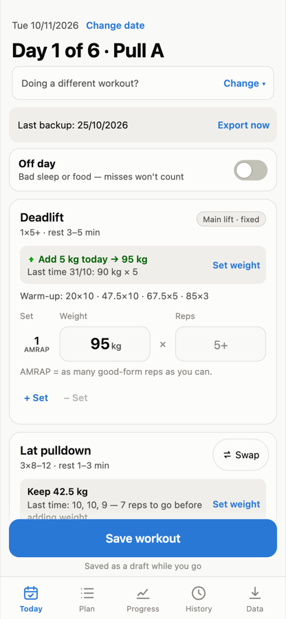
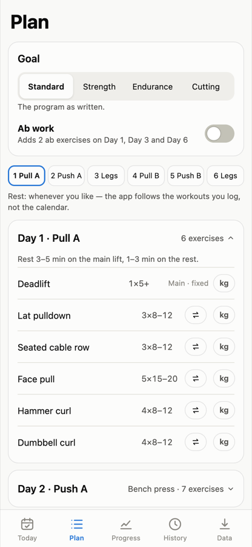
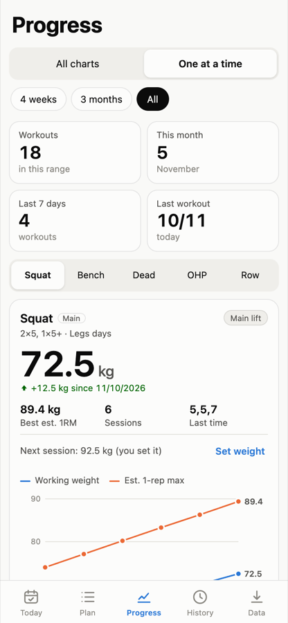
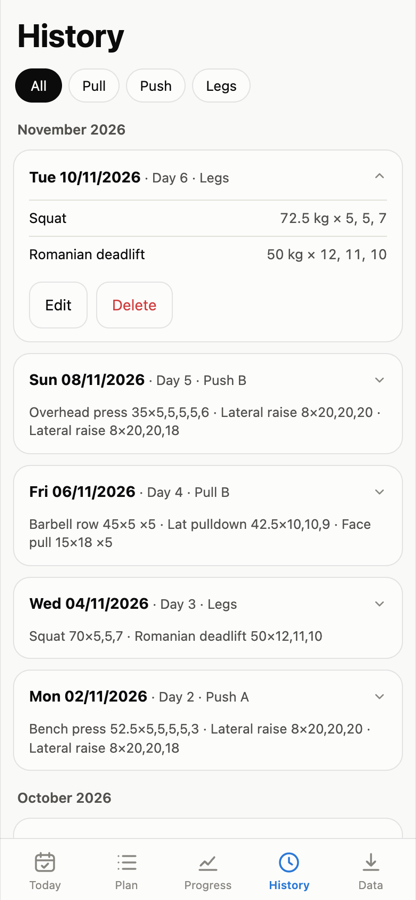
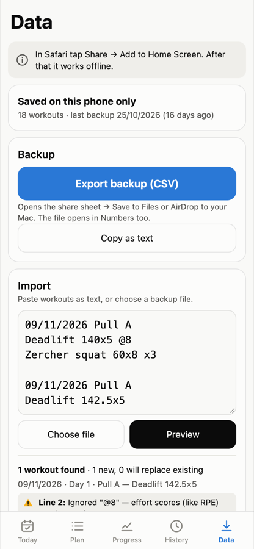

# PPL Tracker

An offline iPhone home-screen web app for the r/Fitness **"A Linear Progression Based PPL Program for Beginners"** (Metallicadpa PPL). It plans each workout, fills in the weights, applies the program's progression and deload rules, and shows progress over time. No accounts, no server, no network: all data stays on the phone, with a CSV backup the user can save or AirDrop.

**Live:** https://workout-tracker-5ik.pages.dev. In Safari, tap Share → Add to Home Screen, then use the icon; it works offline after the first load.

| Today | Plan | Progress | History | Data |
|---|---|---|---|---|
|  |  |  |  |  |

## What it does

- **Day 1–6 cycle:** Pull A → Push A → Legs → Pull B → Push B → Legs. The cycle follows the workouts you log, never the calendar: skipped days change nothing, and the app never says "missed".
- **Weights filled in for you:**
  - main lifts go up 2.5 kg (deadlift 5 kg) after a clean session;
  - after 3 misses in a row at the same weight, 10% comes off;
  - accessories go up once every set hits the top of the rep range;
  - the main lift shows a warm-up ramp;
  - an off-day switch stops a bad session counting as a miss.
- **Set weight:** sets the weight for any exercise's next session, once. After that the rules take over. The same list sets starting weights on first open.
- **Swaps:** the substitutions from the Reddit post, plus custom names. Also goals (standard / strength / endurance / cutting) and an optional ab add-on.
- **Progress:** two views. *All charts* has a card per exercise; *One at a time* shows one big chart plus the full exercise list. Main lifts chart working weight and estimated 1-rep max; accessories chart weight and total reps against the "add weight" target. Also a watch list, personal bests and weekly volume.
- **Backup:** export a CSV through the iOS share sheet; "Copy as text" copies a readable version. Import takes that CSV, or free text like `Deadlift 100x5 x3`, and shows a preview with warnings by line number first.
- **Units and dates:** kg by default with an lb switch that converts saved weights. Dates show as DD/MM/YYYY, and typed numeric dates are always read day-first.

## Run it locally

No dependencies and no build step. Serve `public/` with any static server:

```sh
python3 -m http.server 8000 --bind 127.0.0.1 --directory public
# open http://127.0.0.1:8000/
```

The service worker (offline mode) works on `127.0.0.1`/`localhost` and on HTTPS. A phone on your Wi-Fi visiting the Mac's IP over plain HTTP can view the app but won't get offline mode.

## Tests

| Command | What it runs | Needs |
|---|---|---|
| `npm test` | 392 unit tests for every logic module (Node's built-in runner) | Node 22+ (developed on 24) |
| `TZ=Asia/Kolkata npm test` | the same, in another time zone (date logic must not shift) | |
| `node tests/e2e/run.js` | 24 end-to-end scenarios in headless Chrome at iPhone size, plus "no outside requests" and "no console errors" | Google Chrome (set `CHROME_PATH` if it isn't in /Applications) |
| `node tests/e2e/run.js swap offline` | only the scenarios whose id contains those words | |
| `node tests/e2e/selfcheck.js` | checks the e2e harness itself | |

The e2e tests find elements by **accessible name** (button text, `aria-label`), so renaming a button or label can break them. The names are a contract, listed in [`docs/SPEC.md` §16.3](docs/SPEC.md). End-to-end screenshots go to `/tmp/ppl-shots/e2e/`.

## Layout

```
public/                 ← the deployed site (and only this folder)
  index.html, css/app.css, manifest.webmanifest, sw.js, icons/
  js/
    program.js          the program: exercises, days, slots, swaps, goals, Day 1–6 cycle
    progression.js      suggestions: increase / repeat / deload, accessory rules, warm-ups, Set weight
    units.js            increments, rounding, kg↔lb, weight formatting
    dates.js            local calendar dates, DD/MM/YYYY, day-first parsing
    parser.js           free-text import/export
    csv.js              CSV backup format
    store.js            app state, localStorage load/save/migrate, merging imports
    analysis.js         Progress numbers: e1RM, series, PBs, weekly volume, watch list
    charts.js           SVG chart markup (pure)
    html.js             the one HTML escaper
    app.js              boot, routing between tabs, saving, service worker, banners
    ui/                 one module per screen + shared sheets, DOM helpers, chart interaction
tests/                  unit tests (*.test.js) and tests/e2e/ (browser tests + harness)
tools/make-icons.mjs    regenerates the PNG icons with headless Chrome (not deployed)
docs/                   SPEC.md, DECISIONS.md, design/ (approved mocks), screenshots/
```

## Rules for changing it

1. **No dependencies, no build step, no network calls**, no CDN, no web fonts. The app must work in airplane mode.
2. **Every rule lives in one logic module.** The UI never re-implements one: suggestions come from `progression.js`, the cycle from `program.js`, rounding from `units.js`, dates from `dates.js`. Logic modules are pure (no DOM, no storage at import time) so Node can test them.
3. **Dates are local `YYYY-MM-DD` strings.** Never use `toISOString()` for "today": in India it gives yesterday before 05:30.
4. **All user text is escaped** (`html.js` / the `html` template tag in `ui/dom.js`).
5. **Tests first:** change or add the tests for a rule, then the code. Run both suites before pushing.
6. **When anything in `public/` changes, bump `CACHE` in `public/sw.js`** (`ppl-v3` → `ppl-v4`) and keep its `PRECACHE` list equal to the real file list. Otherwise installed phones keep the old version. The app shows "Update ready — tap to reload" when a new version arrives.
7. **Keep stored data compatible.** State lives in `localStorage` under `ppl-tracker-v1`; `store.migrate()` must accept every older shape. Users can't be asked to reset.

## Deploying

Cloudflare Pages is connected to this repo: framework none, no build command, output directory `public`, production branch `main`. **Every push to `main` goes live within about a minute.** Work on a branch and merge when both test suites pass.

## Docs

- [`docs/SPEC.md`](docs/SPEC.md): the full specification (program rules, progression, import formats, screens, offline behaviour, test contract).
- [`docs/DECISIONS.md`](docs/DECISIONS.md): the product decisions and why, plus what changed after the final review.
- [`docs/design/`](docs/design/): the approved design mocks as self-contained HTML (sample data). Open in a browser; add `?theme=dark` for dark mode, `?view=all` / `?view=focus&focus=latPulldown` on `progress.html`, and `?only=0`…`4` on `screens.html` to show one screen.

## Credits

Training program: "A Linear Progression Based PPL Program for Beginners" by u/Metallicadpa on r/Fitness. This app is an independent tracker for it.
